关键词：**MoE 解码**、权重主导调度、:mdnice-bold-italic[持久化MegaKernel]、FP8 量化、**vLLM**

> “在 vLLM 的实测中，路由式 MoE 层占据了端到端解码延迟的最高 40%”。这确实是当前 MoE 大模型推理的核心尴尬：明明是稀疏计算，理论上应该更快，实际却成为了延迟的主要来源。

Mixture-of-Experts（MoE）层通过稀疏激活的方式提升模型容量，无需按比例增加算术运算量，但在自回归解码阶段，**其稀疏专家计算难以高效执行**。现有的分组与批量 GEMM 均为 Token 主导架构：它们构建专家本地 Token tile，从 Token 维度获取并行性。:mdnice-bold-italic[当每个专家仅收到少量 Token 时，这种组织方式会带来 tile 填充与预处理开销，启动短命的计算网格导致内存带宽利用率低下，且将量化、激活与归约拆分为独立阶段。]

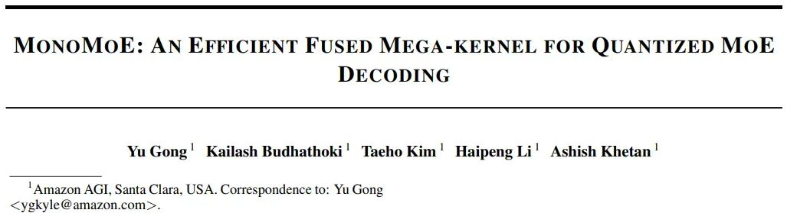

- **MonoMoE: An Efficient Fused Mega-Kernel for Quantized MoE Decoding**
- 组织机构：Amazon AGI（美国圣克拉拉）
- 论文链接：https://arxiv.org/pdf/2609.04244
- :mdnice-bold-italic[开源代码：https://github.com/flashinfer-ai/flashinfer/tree/main/csrc/fused_moe/monomoe]

::: related-title
**相关推荐**
:::

::: related-links
- **[SF Tensor 用 Lean 形式化 PTX，证明 GPU Kernel 的正确性，覆盖在线FA、MoE与简单MegaKernel](https://mp.weixin.qq.com/s?__biz=MjM5NDczOTA4NQ==&mid=2447907748&idx=1&sn=179bac5258efec1ba1d34f5aa3096627&scene=21#wechat_redirect)**
- **[北大开源 PipeLink 把 MegaKernel 拆成可拼接组件：解码最快提速 2.16 倍，MoE 训练性能追平原生整块巨核！](https://mp.weixin.qq.com/s?__biz=MjM5NDczOTA4NQ==&mid=2447907574&idx=1&sn=0bdc690b1c8aefa149e48b7eb413ba29&scene=21#wechat_redirect)**
- **[Weave：面向计算通信重叠的 MoE MegaKernel 细粒度动态 SM 调度，较 DeepEP 1.95 倍层加速，1.12 倍端到端提速](https://mp.weixin.qq.com/s?__biz=MjM5NDczOTA4NQ==&mid=2447906220&idx=1&sn=177db891e7fc7087f94090009ef44dc4&scene=21#wechat_redirect)**
- **[拆解 megakernel 性能神话：普通 CUDA 内核靠 PDL 调度实现 97.4%持久化吞吐](https://mp.weixin.qq.com/s?__biz=MjM5NDczOTA4NQ==&mid=2447905121&idx=1&sn=f93dceb62089296ffcabc24c964e94c3&scene=21#wechat_redirect)**

:::

> 本文提出的 MonoMoE，是一种**面向分块量化 MoE 解码的权重主导持久化 MegaKernel**。MonoMoE 将完整的解码步 Token tile 置于细粒度张量核心的 N 维度，在专家权重 tile 上划分 CTA，消除了专家本地 Token 物化，减少了填充计算量。

持久化网格在单次启动中融合了路由、Top-K 选择、量化、两次专家投影、激活与归约；Warp 特化与就绪标志位将辅助工作与主导的专家权重流重叠执行。**MonoMoE 已与 vLLM 集成**，通过生成式内核特化与离线调度调优支持多种模型结构。

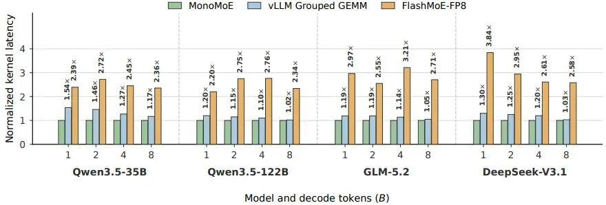

::: image-caption
图 8：合成路由下，独立路由 MoE 算子的归一化延迟。每个模型与 token 数量组均以 MonoMoE 为基准归一化为 1.0，柱状图从左到右依次为 MonoMoE、vLLM 分组 GEMM、FlashMoE-FP8。标签标注相对延迟，数值越低性能越好。该图呈现了内核级的性能对比结果，全面验证了 MonoMoE 的设计优势。在所有评测模型与批量大小下，MonoMoE 均显著优于两个基线：相对 vLLM 分组 GEMM 取得 1.02–1.54 倍加速，相对 FlashMoE-FP8 取得 2.20–3.84 倍加速。加速比随 batch 增大而收窄，符合理论预期 —— 当 token 数增多时，token-major 架构的填充与流水线开销被逐步摊薄。FlashMoE 尽管同样采用持久内核设计，但受限于 token-major 的本质，在小 batch 下依然存在严重的 tile 填充与并行度不足问题，因此性能差距最为显著。这组数据直接证明了 weight-major 架构在解码场景下的结构性优势。
:::

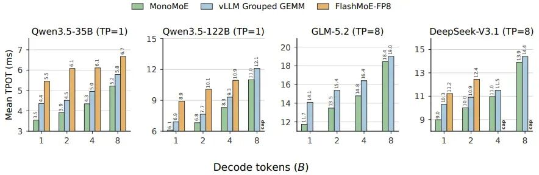

::: image-caption
图 9：不同解码 token 数量下，Sonnet 工作负载的平均单 token 生成时间（TPOT）。端到端结果中，FlashMoE-FP8 在原始 FlashMoE 实现基础上增加了 FP8 量化，同时保留了分发与合并逻辑。两款 Qwen 模型与支持的 DeepSeek-V3.1 配置均有对应结果；cap 标记（字很小不仔细看看不到）表示初始化阶段被拒绝的配置，原因是 FlashMoE 预估的专家 + 分发处理器数量超出了 H200 固定的 132 SM 预算。MonoMoE 可通过调优配置执行所有展示的模型形状。FlashMoE-FP8 无法集成到 vLLM 的 GLM-5.2 服务路径中，因此 GLM-5.2 子图仅对比 MonoMoE 与 vLLM 分组 GEMM。 该图展示了真实服务场景下的端到端性能收益，体现了 MonoMoE 的实际落地价值。单卡 Qwen 模型上，MonoMoE 将 TPOT 降低了 9.9%–18.7%，提升幅度与内核级加速比基本匹配；多卡张量并行的模型收益被通信与非 MoE 计算稀释，但仍有 2.9%–16.7% 的延迟降低。同时 FlashMoE 存在明显的配置上限，大模型高 batch 场景无法运行，而 MonoMoE 的固定网格设计支持所有评测配置，部署兼容性更强。这组结果说明 MonoMoE 不仅在算子层面有理论优势，在完整的服务链路中也能带来可落地的延迟提升，同时具备更好的模型适配能力。
:::

在 NVIDIA H200 GPU 上，MonoMoE 将完整路由 MoE 算子的性能较 vLLM Triton 分组 GEMM 提升最高 1.54 倍；在多种模型与批量大小下，速度是 FlashMoE FP8 适配版的 2.20–3.84 倍；在所有评测的 FP8 模型上，端到端每输出 Token 时间最高降低 18.7%，同时保持任务精度不变。**MonoMoE 的实现与相关工件已开源，收录于 FlashInfer 代码仓库。**

## 本文目录

- 一、MoE 解码的性能困局：为什么越稀疏反而越慢？
  - 1.1 MoE 模型的“容量红利”与“解码诅咒”
  - 1.2 现有 MoE 内核的通用设计范式
- 二、瓶颈拆解：Token 主导调度的三重原罪
  - 2.1 Token 预处理：大量填充带来的算力浪费
  - 2.2 内存吞吐不足：短命网格的流水线启停损耗
  - 2.3 辅助工作串行：本可隐藏的延迟全部暴露在关键路径
- 三、MonoMoE 核心设计：权重主导的调度范式重构
  - 3.1 从 Token 主导到权重主导：SwapAB 的矩阵映射革命
  - 3.2 消除片外 Token 重组：原生 Token tile 的片上路由
  - 3.3 持久化网格：固定 CTA 常驻，跨专家流水作业
- 四、全链路融合：持久化内核的异步重叠流水线
  - 4.1 动态 Warp 特化：计算与访存的职责拆分
  - 4.2 四级重叠机制：把所有辅助工作藏进权重流
  - 4.3 就绪标志位：细粒度生产者-消费者交接
- 五、工程落地：泛化接口与离线调优体系
  - 5.1 通用内核接口：编译期特化+运行时参数的分层设计
  - 5.2 离线调度调优：自动枚举+性能排序的配置生成
  - 5.3 vLLM 集成：无缝接入生产级推理框架
- 六、实测表现：从内核级到端到端的全面验证
  - 6.1 内核级性能：全面碾压基线与竞品
  - 6.2 数值精度验证：余弦相似度 ≥0.998 的精度保障
  - 6.3 端到端服务性能：全模型场景的延迟收益
  - 6.4 下游任务精度：无精度损失的性能提升
- 七、总结与展望：MoE 推理内核的演进方向
  - 7.1 MonoMoE 的适用边界与局限
  - 7.2 分布式场景的融合空间
  - 7.3 未来演进方向

## 一、MoE 解码的性能困局：为什么越稀疏反而越慢？

> Mixture-of-Experts（MoE）架构被视为大模型扩容的核心路径之一，它通过稀疏激活专家的方式，在不按比例增加计算量的前提下大幅提升模型容量。

但这一架构的优势在自回归解码阶段并没有完全释放，反而因为稀疏性带来了新的效率瓶颈，成为推理延迟的主要来源之一。

### 1.1 MoE 模型的“容量红利”与“解码诅咒”

> MoE 模型的核心逻辑是将每一层的前馈网络（FFN）替换为一组稀疏激活的专家，每个 Token 仅会被少数专家处理。这种设计让模型参数量可以大幅扩张，但每个 Token 的实际计算量并不会同比例增长，因此在训练与预填充阶段能够获得显著的算力效率优势。

但解码阶段的场景完全不同。自回归解码每一步只会生成少量 Token，这些 Token 会被路由到大量不同的专家中，导致每个专家分到的 Token 数量极少。此时 MoE 的稀疏性不再是优势，反而变成了效率负担：专家权重需要从 HBM 中读取，但每个权重对应的计算量很少，整个过程变成了典型的内存绑定场景。

论文中的实测数据显示，**在 vLLM 框架下，路由 MoE 层占据了端到端解码延迟的最高 40%。** 每一步解码中，选中的专家计算量很小，但需要从 HBM 中读取对应的专家权重，因此:mdnice-bold-italic[尽管 FLOP 数不高，专家执行却受限于内存带宽。量化权重与激活可以减少数据流量，但路由、激活力化、缩放因子处理仍然留在关键路径上。]

### 1.2 现有 MoE 内核的通用设计范式

> 当前主流的 GPU MoE 内核普遍将专家计算实现为分组或批量 GEMM。**这些实现从根本上都是 Token 主导的**：被路由的 Token 构成 GEMM 的 M 维度，工作负载被划分为专家本地的 Token 与输出 tile。

这种组织方式在训练、预填充和大批量服务场景下非常有效，因为每个专家能收到足够多的 Token 来填满 tile ，提供充足的并行性。**但解码场景恰好相反，少量 Token 分布在大量专家中，导致 Token tile 大部分为空，运行时需要为短暂、低并发的计算网格构建专家本地工作列表。**

更关键的是，MoE 的前向传播被拆分为独立的路由、量化、门控/上投影、激活、下投影和归约内核。每一个内核边界都会中断专家权重流，让原本可以与权重移动重叠的辅助工作暴露在关键路径上。即使是内核融合的方案，如果没有改变 Token 主导的调度本质，也无法从根本上解决问题。

::: block-1
总之，:mdnice-highlight[MoE 解码的性能困局本质上是“稀疏计算形态”与“GPU 硬件并行模型”的错配]，现有 Token 主导的调度范式天然适配大批量训练与预填充场景，**却在小批量解码阶段陷入了填充多、吞吐低、串行重的三重困境，这也是 MonoMoE 要解决的核心问题。**
:::

## 二、瓶颈拆解：Token 主导调度的三重原罪

> 为了量化 MoE 解码的优化空间，论文首先做了保守的权益分析，将可恢复的延迟拆分为内核边界间隙与带宽恢复两部分。

这份分析不仅给出了理论上限，更精准定位了 Token 主导调度的三个核心缺陷，为后续的架构重构提供了明确的靶点。

### 2.1 Token 预处理：大量填充带来的算力浪费

> 构建 Token 主导的 GEMM，需要将 Token-专家分配关系转换为专家本地的行。

如果专家 e 收到 $B_e$ 个 Token，它的调度行数会向上取整到 M tile 的粒度，总调度行数为：

$$
M_{sched }=\sum_{\epsilon \in A}\left\lceil\frac{B_{e}}{ BLOCK_M }\right\rceil × BLOCK_M
$$

其中 A 是激活专家的集合。在解码场景下，$B_e$ 通常远小于 BLOCK_M，因此大部分调度行位置都是填充位。

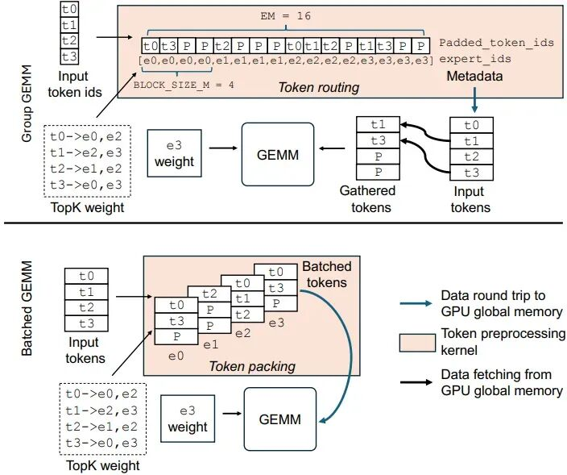

::: image-caption
图 3：分组与批量GEMM的Token主导预处理。基于元数据的分组GEMM对专家本地Token索引列表进行填充，而连续分组与批量布局会物化专家排序的Token特征。所有情况下，专家本地Token维度都会对齐到GEMM M tile 粒度。无论是元数据索引还是特征物化，Token主导调度都无法避开填充开销，区别只是浪费的是算力还是内存带宽。在小批量解码场景下，这种填充的占比会被放大到极致，成为不可忽视的性能损耗。
:::

> 这种填充是 Token 主导分解的固有问题，只是不同实现的物化方式不同。

- **以分组 GEMM 为例，当路由对均匀分布在 R 个专家上时，最坏情况下每个专家只有一对 Token-专家**，此时调度行数为 $R \cdot BLOCK_M$，有效行占比仅为 $1/BLOCK_M$。比如批量大小为 8、Top-K 为 8、BLOCK_M 为 16 时，1024 个调度行里只有 64 个有效行，填充率高达 93.75%。
- **批量 GEMM 的情况同样糟糕。** 如果所有 Token 都选择相同的 k 个专家，那么只有 k 个专家切片有数据，有效行占比为 $k/E$，256 个专家选 8 个的话，:mdnice-bold-italic[有效占比仅 3.125%，这还没算 tile 对齐的额外填充。]

### 2.2 内存吞吐不足：短命网格的流水线启停损耗

> 尽管解码阶段的主导开销是权重移动，但 Token 主导的 GEMM 在这种场景下无法达到峰值 HBM 带宽。对于输出宽度为 O 的专家投影，输出 tile 数量为：

$$
T=\sum_{e \in A}\left\lceil\frac{B_{e}}{ BLOCK_M }\right\rceil \times\left\lceil\frac{O}{ BLOCK_N }\right\rceil
$$

每个 CTA 计算一个（M tile ，N tile ）输出 tile ，并流式读取对应的专家权重面板。当每个激活专家只贡献一个几乎为空的 M tile 时，网格大小主要由激活专家数和输出列 tile 数决定，网格可能太小或寿命太短，无法维持足够的未完成 HBM 请求。

::: block-1
:mdnice-highlight[这种效应表现为不连续的权重加载流。根源在于短 tile 序列周围反复的启动、专家查找或描述符选择、以及销毁过程。] 批量 GEMM 用 TMA 对加载做了流水线处理，但短调度仍然没有足够的稳态区间。分组 GEMM 的 tile 全局内存加载流水线也有类似问题。
:::

论文中的实测显示，批量大小为 1 时，分组 GEMM 的上投影内核生命周期里，填充和排空阶段占了 63%的时间，稳态平均带宽仅为峰值的 34.9%。**随着批量增大，更多专家被激活或专家获得更多 M tile ，网格级并发度和权重请求持续时间都会增加，带宽才会逐步提升。**

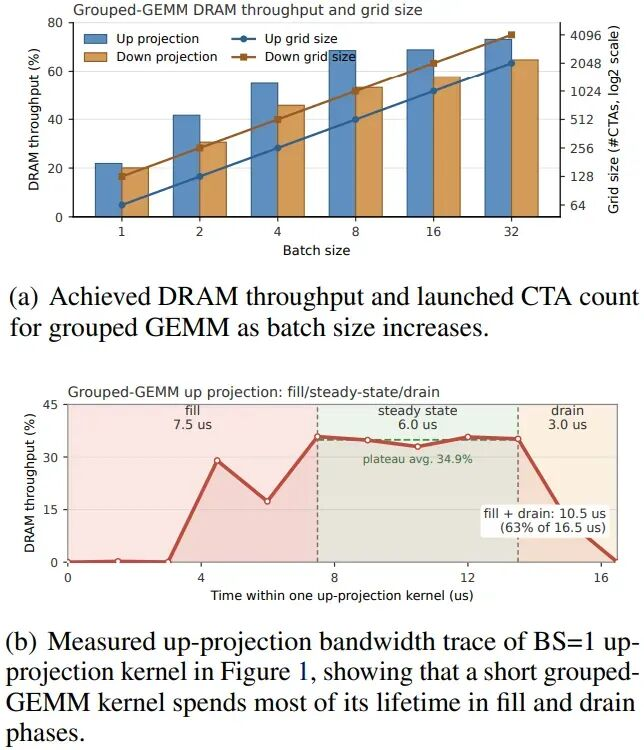

::: image-caption
图 4：分组GEMM的DRAM吞吐量限制。上图展示了随着批量增大，分组GEMM的DRAM吞吐量与启动CTA 数量的变化；下图是批量大小为1时上投影内核的带宽轨迹，显示短生命周期的分组GEMM内核大部分时间都处于填充和排空阶段。内存流水线的填充和排空是短内核的固有损耗，内核越短，损耗占比越高。解码场景的专家GEMM恰好属于极短内核，因此吞吐率远低于硬件峰值。
:::

### 2.3 辅助工作串行：本可隐藏的延迟全部暴露在关键路径

> MoE 层的理想下界延迟，是确定选中专家并读取其权重的时间；其余工作只要依赖允许，都应该与主导的权重流重叠。但基线方案中，量化、Token 路由、专家投影、SiLU 激活和归约都作为独立内核启动，每个内核的输出都要写回片外内存，下一个内核才能读取。

论文给出的单层时间线清晰展示了这个问题：批量大小为 1 时，两个专家 GEMM 用 23.0 微秒流式加载权重，同时默认流上还有约 23 微秒的低带宽辅助工作。**除了 3.4 微秒的路由内核和已经隐藏的共享专家门控，其余辅助内核几乎不消耗 DRAM 带宽**，它们属于调度松弛，而非不可避免的权重流量。

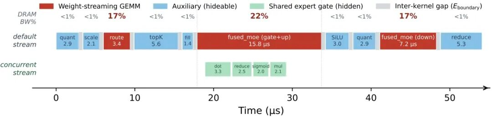

::: image-caption
图 1：批量大小为1时单层MoE的内核时间线（Qwen3.5-35B-A3B-FP8，H200，vLLM + Triton fused moe + torch.compile + CUDA Graph）。两个权重流式GEMM占据了主要墙钟时间，但仅能达到峰值DRAM带宽的17-22%；所有辅助内核的带宽占比均低于1%，完全可以隐藏在连续的权重流之下。共享专家门控在并发流上执行，与gate+up投影完全重叠。这张图直观展现了MoE解码的核心矛盾——占时长的GEMM带宽利用率极低，而占比小的辅助工作全部串行暴露，两者共同推高了整体延迟。如果能维持连续的权重流，辅助工作几乎不会额外增加延迟。
:::

**换句话说，这些辅助工作本不该占用额外的墙钟时间，但因为串行的内核执行，它们全部暴露在了关键路径上，让整体延迟几乎翻倍。** 对于分块量化模型来说，这个问题尤其突出：:mdnice-bold-italic[激活力化本身计算量很小，但放在关键路径上就会变得可见。]

> 论文将总可恢复延迟拆分为两部分：

$$
E_{total }=E_{boundary }+E_{throughput }
$$

其中 $E_{boundary}$ 是内核间的空闲时间，也就是内核启动与销毁带来的间隙；$E_{throughput}$ 是将持续 HBM 带宽从基线水平提升到稳态水平后恢复的延迟。

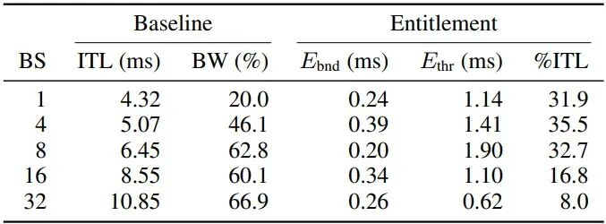

::: image-caption
表 1：Qwen3.5-35B-A3B-FP8（E=256，top-k=8）在H200上的单内核权益分析（vLLM服务，1600输入、600输出Token）。BW(%)是基线fused moe triton内核达到的峰值HBM带宽占比。随着批量增大，带宽利用率逐步提升，可优化空间快速收窄。批量1时带宽仅20%，有超过三成的延迟可以优化；批量32时带宽接近峰值，优化空间不足一成。这也验证了小批量解码是MoE内核的核心优化场景。
:::

在 Qwen3.5-35B-A3B-FP8 模型上的实测显示，批量大小 1-8 时，单内核可以恢复 32-36%的 Token 间延迟；批量 32 时仅剩下 8%的优化空间，因为此时基线 GEMM 已经能达到约 67%的峰值带宽。**这也说明小批量解码是优化空间最大的场景。**

::: block-1
回顾一下，Token 主导调度的三个核心缺陷分别是:mdnice-bold-italic[tile 填充带来的算力浪费、短命网格带来的带宽损耗、串行执行带来的辅助延迟暴露。三者叠加，让小批量下的 MoE 解码效率远低于理论水平，这也是 MonoMoE 要逐个击破的核心靶点。]
:::

## 三、MonoMoE 核心设计：权重主导的调度范式重构

> 针对 Token 主导调度的三重缺陷，MonoMoE 提出了完全相反的设计思路：权重主导分解。简单来说，就是**让 Token 占据张量核心运算的小维度，而将持久化网格划分在专家权重 tile 上，从权重矩阵而非 Token 块中获取并行性。**

### 3.1 从 Token 主导到权重主导：SwapAB 的矩阵映射革命

现代 GPU 架构（包括 Hopper 和 Blackwell）的张量核心提供了 8 的倍数的细粒度 N 维度形状。这种不对称性，正是权重主导分解的硬件基础。

MonoMoE 没有在专家本地 Token 块和输出列块上划分网格，**其是在专家权重 tile 上划分：每个 CTA 拥有一行输出条带，流式读取对应的权重面板，并将其应用到完整的解码步 Token tile 上。** 因此 Token 维度是每个 CTA 内部的操作数维度，而非 CTA 级工作的来源。:mdnice-bold-italic[这种映射即使在专家 Token 太少、无法形成多个 M tile 的情况下，也能从大型权重矩阵中获得并行性。]

::: block-1
具体的矩阵变换通过 SwapAB 实现。设专家 e 的紧凑激活 $X_e$ 形状为 $B_e × D$，原始 Token tile 的专家掩码视图 $\tilde{X}_e$ 形状为 $B × D$，专家权重 $W_e$ 形状为 $D × O$，则传统与权重主导的公式分别为：

$$
\begin{array} {r}{Y_{e}=X_{e}W_{e}:(M,N,K)_{std}=\left( B_{e},O,D\right) , }\\ {\tilde {Y}_{e}^{\top }=W_{e}^{\top }\tilde {X}_{e}^{\top }:(M,N,K)_{SwapAB}=(O,B,D),}\end{array}
$$

其中 D 是归约维度，O 是专家输出宽度。SwapAB 交换了逻辑操作数的角色，产生转置的输出布局；它不需要启动转置内核，也不需要通过全局内存移动额外的张量。
:::

对于 FP8 来说，Hopper 的 WGMMA 支持 N=8 到 256、步长为 8 的配置，Blackwell 的 UMMA 路径也提供类似的小 N 形状。**MonoMoE 会选择覆盖解码步 Token 数的最小支持 N 形状。更细的 N 粒度也减少了填充计算量。**

以最小支持形状 N=8 为例，相比 Token 主导的 BLOCK_M=16 基线，一个激活专家的 Token 侧张量核心计算量直接减半。**更普遍的情况是，MonoMoE 会根据解码步 Token 数选择更宽的 N 形状，计算节省取决于路由分布，当选中的 N 形状小于聚合的 Token 主导 M tile 占比时，收益最大。**

### 3.2 消除片外 Token 重组：原生 Token tile 的片上路由

> 在 Token 主导的方案中，Token 需要按专家排序，或者分发到带容量填充的[E, M, H]张量中，这会带来一次片外内存的往返。而 MonoMoE 的输入保持原始的密集 $B × H$ tile ，Token 既不按专家排序，也不被分发到专家主序的张量中。

每个常驻 CTA 将输入 tile 加载到片上，使用紧凑的路由元数据选择与当前专家相关的 Token 通道。未使用的 MMA 通道通过逻辑掩码处理；没有分配 Token 的专家会被完全跳过。

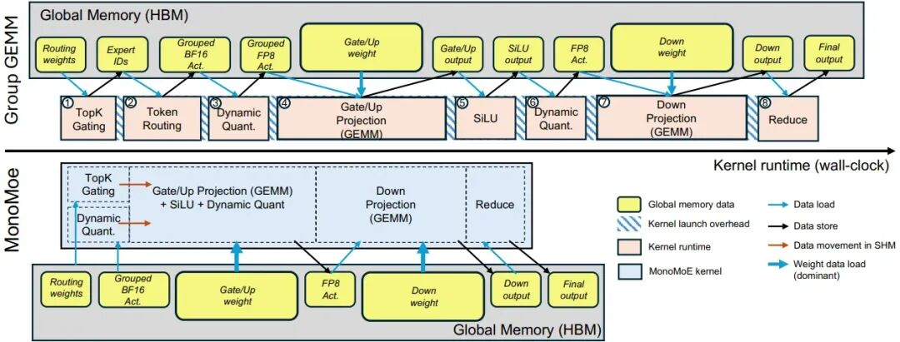

::: image-caption
图 2：Token主导的分组GEMM从填充的Token和输出 tile 中拆分工作，然后将两个专家投影作为独立阶段执行。MonoMoE则将Token放在MMA 的小轴上，沿着专家权重 tile 构建持久化网格，并在融合投影过程中将路由状态保留在片上。这张图清晰对比了两种调度范式的数据流差异。Token主导需要多次片外读写，而权重主导将所有中间状态保留在片上，整个流程只有一次权重流入和一次结果流出，大幅减少了内存访问开销。
:::

::: block-1
这种设计消除了片外的置换或分发往返，同时也减少了张量核心的空闲通道。**所谓的“无填充”指的是路由激活存储层面：MonoMoE 去掉了 Token 预处理的片外内存开销**，同时也减少了但并非完全消除未使用的张量核心通道。
:::

### 3.3 持久化网格：固定 CTA 常驻，跨专家流水作业

> Token 主导的短命网格反复承担内存流水线的填充和排空开销，**MonoMoE 则改变了执行粒度：一组固定的常驻 CTA 在整个 MoE 层保持活跃，每个 CTA 在两次投影中处理来自多个专家的工作**。这将大量短权重流变成了更少的长生命周期流，让内存系统有足够的时间和未完成请求来接近稳态。

- **在常驻策略上，MonoMoE 每个 SM 最多启动一个 CTA，通过每个块一个启动边界加上动态共享内存分配来强制执行单 CTA 驻留。** 主机启动器会根据 SM 数量限制网格大小，并在运行时验证实际占用率。:mdnice-bold-italic[这种驻留保证对于内核内同步非常重要：所有 CTA 并发调度，因此消费者可以安全地等待就绪标志，而生产者继续运行。] 内核仍然是标准的 CUDA 启动，而非协作启动，因此仍然可以被 CUDA Graph 捕获。
- **在专家流式调度上，MonoMoE 将 CTA 分组仅作为内核内调度机制**，而非 3D GEMM 风格的专家主序激活布局或分布式专家并行划分。同一组的 CTA 共同覆盖一个专家的输出范围，然后以等于组数的固定步长遍历专家列表。因此一个 CTA 在其生命周期内会处理一系列专家。

MonoMoE 为上下投影独立选择 CTA 组大小，让每个 GEMM 使用适合其输出形状的划分。

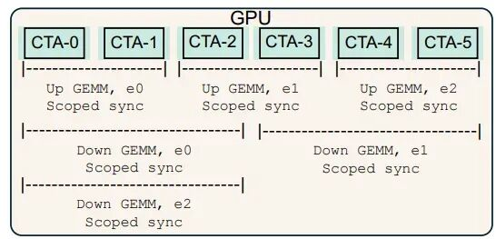

::: image-caption
图 6：三个专家、六个CTA 的MonoMoE持久化调度示例。上投影阶段，CTA 形成三个双CTA 专家组：同组CTA 流式读取相同专家的权重，计算不相交的输出条带。然后各组以轮询顺序遍历专家。下投影使用不同的分组，每个激活专家对应三个CTA，但遵循相同的专家本地权重流式和条带式输出划分模式。这种分组轮询的调度方式，让每个CTA 都能持续保持工作状态，避免了单专家处理完后的空闲等待，同时也让权重加载流水线可以跨专家衔接，减少了冷启动开销。
:::

就绪标志位连接了这些调度：下投影组只需要等待其所需的上投影数据发布即可，不需要两次投影共享相同的 CTA 分组。在每次投影中，同一个 CTA 对它访问的每个专家都拥有相同的输出条带，因此缩放布局、累加器布局和共享内存分块在整个循环中保持稳定。

::: block-1
整体看下来，:mdnice-highlight[权重主导调度的核心在于重构了 MoE 计算的并行来源：并行性不再依赖每个专家的 Token 数量，而是来自权重矩阵本身的维度]。这从根本上适配了小批量解码的稀疏特性，同时也为后续的全链路融合与异步重叠打下了架构基础。
:::

## 四、全链路融合：持久化内核的异步重叠流水线

> 单内核持久化只是基础，真正的性能收益来自于精细的异步重叠设计。

MonoMoE 通过**动态 Warp 特化，将计算与访存职责拆分**，把路由、量化、激活、归约等所有辅助工作都隐藏到权重加载的间隙中，让层延迟尽可能接近权重读取的理论下界。

### 4.1 动态 Warp 特化：计算与访存的职责拆分

> MonoMoE 的每个 CTA 包含固定的 8 个计算 Warp 和 4 个预取/收尾 Warp，但它们的**工作会随着流水线阶段变化：计算 Warp 从路由和 Top-K 选择切换到张量核心 GEMM，预取 Warp 则在异步数据移动、缩放因子加载、延迟收尾工作之间交替。** 线程索引定义了 Warp 分组，而流水线状态决定了它们当前的角色。

这种分工的核心逻辑是：张量核心计算和异步数据移动是两个独立的硬件资源，完全可以并行执行。

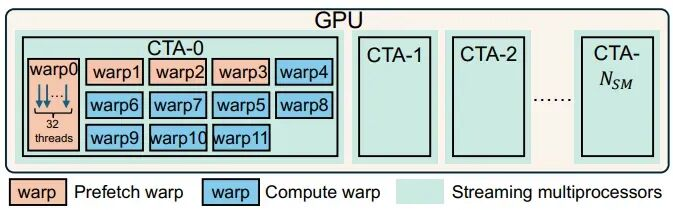

::: image-caption
图 5：MonoMoE持久化网格映射。内核每个SM启动一个CTA，因此具有$N_{SM}$个流多处理器的GPU上，网格包含$N_{SM}$个CTA。每个CTA 包含12个Warp：8个计算Warp发射张量核心工作，4个预取Warp驱动异步数据移动。这种1:1的CTA 与SM映射，加上固定的Warp分工，是持久化内核的典型设计。它保证了每个SM的资源被充分利用，同时也为内核内的细粒度同步提供了基础。
:::

- 让专门的 Warp 负责预取，可以提前发起内存请求，让数据在计算需要时已经就位；
- 让专门的 Warp 负责计算，可以最大化张量核心的利用率。两者配合，就能把内存延迟完全隐藏在计算背后。

每个 CTA 共有 12 个 Warp，其中 8 个计算 Warp 发射张量核心工作，4 个预取 Warp 驱动异步数据移动。每个 Warp 32 个线程，因此每个 CTA 共有 384 个线程。

### 4.2 四级重叠机制：把所有辅助工作藏进权重流

> MonoMoE 设计了四层重叠机制，逐层将非关键路径的工作隐藏到权重流中，几乎覆盖了所有辅助操作。

#### 第一层：输入读取与路由对数计算重叠

**路由对数计算只需要很小的路由权重，而完整的输入 tile 稍后才会被专家投影消耗。** 因此 MonoMoE 将输入 tile 异步流式加载到共享内存，同时计算 Warp 计算路由对数。:mdnice-bold-italic[原本串行的输入 HBM 读取，被隐藏在路由计算背后，到量化开始时 tile 已经驻留。]

#### 第二层：元数据准备与输入量化重叠

**路由完成后，一个 Warp 构建紧凑的路由元数据，其余 Warp 以跨步分区量化驻留的输入 tile**。量化后的激活 tile 在整个归约维度上单缓冲，因此上投影可以直接消费它，无需在量化和计算之间交替。加上前一层重叠，输入加载、路由、Top-K 选择、元数据构建、输入量化都从串行关键路径中移除了。

#### 第三层：权重读取与计算重叠

**每次投影都使用流水线化的生产者/消费者循环。预取 Warp 获取未来的权重 tile ，计算 Warp 消费当前 tile**。:mdnice-bold-italic[MonoMoE 使用多级预读：缓冲区在使用前若干次迭代就准备好，保持多个 HBM 传输在途，让每个传输有多个计算窗口完成。] 这种深度让权重加载流水线在迭代间保持满载，产生连续的权重流，让内核维持更高的 DRAM 带宽。

这种预读还可以跨专家边界延伸。在一个专家的最后几次迭代中，预取 Warp 加载下一个专家的第一批 tile ，因此下一个专家开始时缓冲区是热的，而非冷内存流水线。下投影使用相同的调度，同步推进权重和激活预取。

#### 第四层：收尾工作与下一个专家重叠

> 一旦预取 Warp 发起 TMA 请求，张量内存加速器就会异步执行传输，让这些 Warp 在下一个预取点之前处于空闲状态。**MonoMoE 利用这段空闲时间执行融合的单专家收尾工作，将它们从计算 Warp 的关键路径上移走。**

- **对于上投影，门控和上输出、激活非线性、输出缩放归约、转换为下投影输入，都在寄存器和共享内存中执行，只需一次全局存储**，替代了分阶段实现的存储/重载/再量化序列。:mdnice-bold-italic[MonoMoE 在下一个专家归约循环的前几次迭代中，在预取 Warp 上执行这个收尾，将非线性运算、特殊函数操作、归约和存储都隐藏在下一个专家的矩阵乘背后。]
- **下投影遵循相同的模式**：输出缓冲区的累加被延迟到下一个专家的第一次迭代中，由预取 Warp 执行。只有 CTA 序列中的最后一个专家没有后继可以隐藏，才会内联执行收尾。

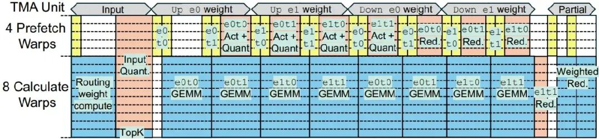

::: image-caption
图 7：CTA 遍历两个专家的动态Warp特化调度。图中标签使用从零开始的专家和 tile 索引，例如$e_0t_0$表示专家0的第一个 tile。4个预取Warp为未来的输入、权重和部分输出 tile 发起TMA 传输，同时8个计算Warp执行路由、Top-K和当前GEMM。上投影后的激活与再量化，以及下投影后的部分累加，都被延迟到预取Warp上，与下一个专家的GEMM重叠。只有最终的加权归约留在流水线排空阶段。这张图完整展示了流水线的重叠逻辑，几乎所有非计算核心的操作都被藏到了下一个阶段的背后。整个流水线只有启动和排空两段有串行开销，中间稳态阶段完全是权重流式加载与计算并行的状态。
:::

### 4.3 就绪标志位：细粒度生产者-消费者交接

> 在持久化启动内部，生产者-消费者顺序通过就绪标志位强制执行，而非阶段级屏障。**生产者完成下一阶段所需的数据后发布标志，消费者只等待与其输入关联的标志。独立的专家组因此可以按不同速率推进**，无需在公共边界同步。

下投影之后，部分和通过 atomicAdd 累加到单个输出缓冲区，相应的就绪状态决定了最终归约何时可以消费完成的输出。这种机制在不引入网格级同步的前提下，保留了数据依赖关系。

同时，MonoMoE 还做了共享内存复用。持久化设计的前提是融合层的活跃状态能放入每个 SM 的共享内存预算。**MonoMoE 使用感知生命周期的共享内存布局，让生命周期不相交的缓冲区复用同一块存储。** 路由窗口输入 tile 、上投影权重 tile 、下投影权重 tile 共享一个区域，因为它们的生命周期不重叠；类似地，收尾临时缓冲区也合并为单个可复用区域。这种复用让持久化占用足够小，能够在目标 tile 大小下维持每个 SM 一个 CTA。

::: block-1
总之，:mdnice-highlight[全链路融合的本质不是简单地多个内核拼成一个，其本质是通过精细的流水线设计，让所有非核心路径的操作都“寄生”在权重流上]。最终的效果是，**整个 MoE 层的墙钟延迟几乎等于读取专家权重的时间，最大限度逼近了理论下界。**
:::

## 五、工程落地：泛化接口与离线调优体系

> 一个优秀的内核设计不仅要性能强，还要具备足够的**通用性** 和工程落地能力。

MonoMoE 通过算法通用性与硬件感知特化的分离设计，既保证了**不同模型的适配能力，又能针对特定形状发挥最优性能。**

### 5.1 通用内核接口：编译期特化+运行时参数的分层设计

> 所有生成的内核都实现相同的概念算子接口：

$$
MonoMoE_{E, H, N, B_{max }, s}\left(X, R, W_{gu}, W_{down}, S, B, k, p\right)
$$

其中 X 是输入 Token tile ，R 表示路由输入，$W_{gu}$ 和 $W_{down}$ 是专家权重，S 包含它们的分块缩放因子，P 是路由策略，s 是选中的调度。

::: block-1
通用内核模板实现了路由、激活力化、两次专家投影、非线性激活和加权归约。Token 数 B、路由扇出 k 和路由策略 p 是运行时参数，而每 GPU 模型形状 $(E, H, N, B_{max})$ 和调度 s 在编译时特化；N 表示张量并行分片后的本地中间宽度。

静态维度让编译器可以精确确定 WGMMA 循环边界、TMA 描述符和共享内存布局。这些特化从声明式形状表生成：支持一个兼容模型只需要注册其每 GPU 形状并重新生成内核实例和分发条目，无需修改底层 MoE 算法。
:::

### 5.2 离线调度调优：自动枚举+性能排序的配置生成

> 对于每个形状，MonoMoE 预编译由 $(GRID, G_{up}, K_{up}, G_{down}, K_{down}, D_{up}, D_{down})$ 参数化的调度。其中 GRID 是持久化 CTA 数量；$G_{up}$ 和 $G_{down}$ 是两次投影中共同处理一个专家的 CTA 数量；$K_{up}$ 和 $K_{down}$ 是对应的归约 tile 宽度；$D_{up}$ 和 $D_{down}$ 是权重预取深度。

上下组大小和预取深度独立选择，就绪标志位连接两次投影调度。配置枚举器只保留满足张量核心可分性、CTA 组兼容性、网格驻留和共享内存容量约束的候选。

然后对候选进行离线调优：未通过数值验证的配置被剔除，其余配置根据目标 Token 数范围和代表性路由分布下的 CUDA Graph 延迟排序。服务时，通过生成的分发表选择与模型形状和 GPU 关联的固定配置。

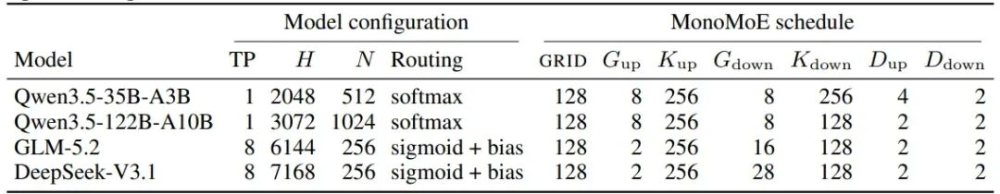

::: image-caption
表 2：评测的分块FP8模型配置与默认MonoMoE调度。维度为单GPU数值；N是TP分片后的本地中间宽度。G_up和G_down是每个专家的CTA 数，$D_{up}$和$D_{down}$是权重预取深度。所有模型使用$E=256$个专家、$top-k=8$，所有CTA 使用384线程。不同模型的调度参数差异很大，尤其是CTA 组大小和预取深度。这说明没有通用的最优配置，必须针对每个模型的形状做定制化调优，才能发挥出最佳性能。
:::

### 5.3 vLLM 集成：无缝接入生产级推理框架

> **MonoMoE 已经完整集成到 vLLM 中，适配了 vLL

M 的 CUDA Graph 解码路径**。这意味着它是可以直接在生产级推理框架中使用的成熟方案。

集成过程中，MonoMoE 保留了 vLLM 原有的 MoE 算子接口，因此上层逻辑无需修改，只需要替换底层内核实现即可。同时它支持多种路由策略，包括 softmax 路由和带专家选择偏置的 sigmoid 路由，能够适配 Qwen、DeepSeek、GLM 等不同系列的 MoE 模型。

对于张量并行场景，MonoMoE 也做了对应适配。虽然内核本身不融合通信操作，但它的输出格式完全兼容张量并行的 all-reduce 操作，能够无缝接入现有的分布式推理流程。

::: block-1
回顾一下，:mdnice-highlight[MonoMoE 的工程落地体系核心是“通用模板+形状特化+离线调优”的三层架]。通用模板保证了功能完整性和可扩展性，形状特化保证了硬件效率，离线调优则确保了每个场景都能拿到最优配置。这种设计兼顾了通用性和性能，是工业级内核的典型实践范式。
:::

## 六、实测表现：从内核级到端到端的全面验证

> 所有设计最终都要靠性能说话。论文在 H200 GPU 上做了全面的评测，覆盖了内核级性能、数值精度、端到端服务性能和下游任务精度四个维度。

评测选择了**四个不同规模的 FP8 MoE 模型，涵盖单卡和八卡张量并行场景**，对比了 vLLM 原生分组 GEMM 和 FlashMoE-FP8 两个基线。

### 6.1 内核级性能：全面碾压基线与竞品

> 隔离内核实验中，研究人员生成了 FP8 专家权重、BF16 输入和路由对数，批量大小覆盖{1,2,4,8}，延迟在 20 次预热迭代后取 200 次 CUDA Graph 重放的平均值。

结果显示，**在所有评测点上，MonoMoE 都显著优于两个基线**。相比 vLLM 分组 GEMM，MonoMoE 在 Qwen3.5-35B 上达到 1.17–1.54 倍加速，Qwen3.5-122B 上 1.02–1.20 倍，GLM-5.2 上 1.05–1.19 倍，DeepSeek-V3.1 上 1.03–1.30 倍。

加速比在 Token 数最少时最大，随着 Token 数增加，Token 主导基线获得更多 GEMM tile 来分摊分发和流水线瞬态开销，优势逐步收窄。这与之前的权益分析结论完全一致。

**相比 FlashMoE-FP8，MonoMoE 的优势更加巨大**。Qwen3.5-35B 上 FlashMoE-FP8 的延迟是 MonoMoE 的 2.36–2.72 倍，Qwen3.5-122B 上 2.20–2.76 倍，GLM-5.2 上 2.55–3.22 倍，DeepSeek-V3.1 上 2.58–3.84 倍。:mdnice-bold-italic[整体来看，FlashMoE-FP8 在每个评测点都比 MonoMoE 慢，整体慢 2.20–3.84 倍。]

::: block-1
更关键的是，FlashMoE 存在调度容量限制：当专家加分发的处理器数量超过 H200 的 132 个 SM 预算时，初始化就会失败。而 :mdnice-highlight[MonoMoE 通过生成的形状特定调度，在固定的持久化网格上重新划分专家权重 tile ，能够执行所有评测的模型形状和 Token 数。]
:::

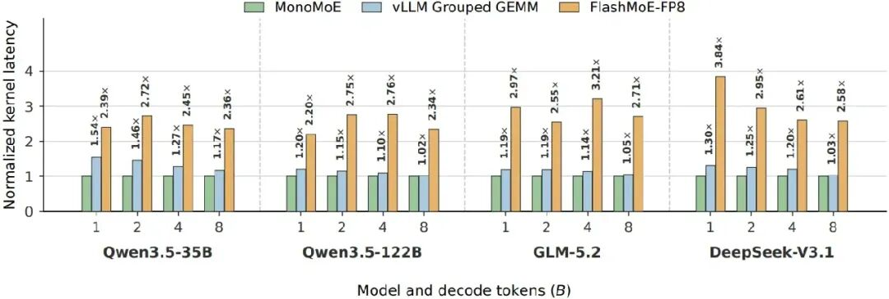

::: image-caption
图 8：合成路由下的隔离路由MoE延迟归一化对比。每个模型和Token数组以MonoMoE为1.0归一化，柱状顺序为MonoMoE、vLLM分组GEMM、FlashMoE-FP8。标签标注相对延迟，数值越低越好。这张图直观展示了三者的性能差距。MonoMoE全面领先，且在小批量下优势最明显；FlashMoE在所有场景下都显著落后，甚至部分配置无法运行。这说明权重主导的调度范式在解码场景下，相比Token主导的持久化内核也有代际优势。
:::

::: block-1
:mdnice-highlight[从性能拆解来看，收益主要来自三个方面：]

- **消除 Token 主导的填充和预处理**，对应减少了 13.2%–26.7%的内核延迟；
- **提升有效内存吞吐**，将峰值占比从 10.62%–45.07%提升到 21.20%–57.99%，提升了 1.29–2.00 倍；
- 以及**将路由、量化、激活、再量化、部分累加与专家权重流重叠**，减少了关键路径上的辅助工作。
:::

### 6.2 数值精度验证：余弦相似度 ≥0.998 的精度保障

> 性能提升不能以牺牲精度为代价。论文从标准高斯分布和自由度为 3 的重尾学生 t 分布中抽取 FP32 激活和专家权重矩阵，每个矩阵归一化到相同的均方根量级，然后应用生产级 BF16 和分块 FP8 转换，路由分配在不同实现间保持固定。

对于每个模型形状和批量大小，研究人员将 MonoMoE 和 vLLM 分组 GEMM 与同一个 FP32 参考对比。**结果显示，在所有评测的分布、模型形状和 Token 数下，余弦相似度都至少为 0.998。这说明 MonoMoE 的数值精度与基线完全相当**，没有因为融合和调度改动引入额外的精度损失。

### 6.3 端到端服务性能：全模型场景的延迟收益

+*-> 端到端性能评测使用 vLLM 内置的固定形状 Sonnet 文本工作负载：50 个提示，每个 1600 输入 Token、200 生成 Token，以及 200Token 的共享前缀。禁用前缀缓存，启用分块预填充，请求并发度遍历$\{1,2,4,8\}$，使用固定种子。

评测指标是平均每输出 Token 时间（TPOT），即每个请求的首个 Token 之后的生成延迟平均值。

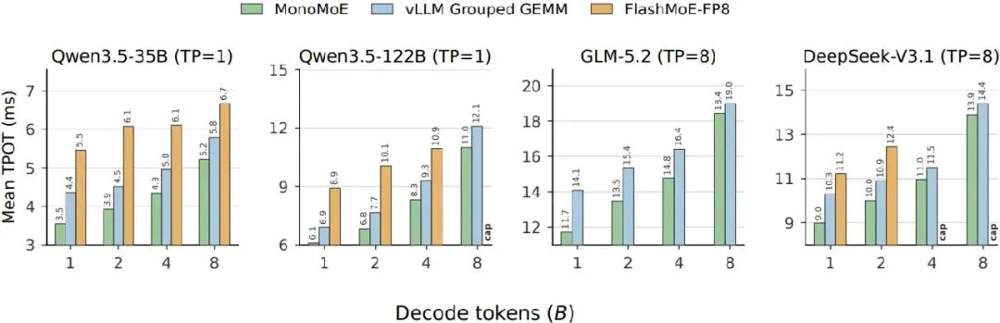

::: image-caption
图 9：不同解码Token数下，Sonnet工作负载的平均TPOT。这些端到端结果中，FlashMoE-FP8在原始FlashMoE实现基础上增加了FP8量化，同时保留了分发和合并。Qwen系列和支持的DeepSeek-V3.1点都有结果。cap标记的是初始化时被拒绝的配置，因为FlashMoE估计的专家加分发处理器数量超过了H200的132个SM固定预算。MonoMoE以调优后的配置执行所有显示形状。FlashMoE-FP8无法集成到vLLM的GLM-5.2服务路径中，因此GLM-5.2面板仅对比MonoMoE与vLLM分组GEMM。端到端的收益虽然比内核级小，但依然非常可观。尤其是单卡模型，在低并发下能获得接近两成的延迟降低，对于延迟敏感的在线推理场景价值巨大。多卡场景收益被通信稀释，但依然有明确的正向收益。
:::

> 结果显示，**在批量大小 1–8 下，MonoMoE 相比 vLLM 分组 GEMM，Qwen3.5-35B 的 TPOT 降低了 18.7%、13.0%、12.3%和 9.9%；Qwen3.5-122B 降低了 11.5%、10.7%、10.7%和 9.1%；GLM-5.2 降低了 16.7%、12.3%、9.9%和 2.9%。**

GLM-5.2 的收益下降最明显，因为它的 8 路张量并行服务路径包含了通信和非 MoE 工作，这些是本地内核无法减少的。

DeepSeek-V3.1 上，MonoMoE 的 TPOT 分别为 8.98、10.00、10.96 和 13.90 毫秒，而分组 GEMM 为 10.3、10.9、11.5 和 14.4 毫秒，对应降低 12.8%、8.3%、4.7%和 3.5%。随着并发度增长，八路张量并行服务路径中的通信和非 MoE 工作越来越稀释本地内核收益。

### 6.4 下游任务精度：无精度损失的性能提升

> 最后，论文在 GSM8K 小学数学推理基准和 HumanEval Python 代码生成基准上做了端到端生成评测，验证精度是否保持。

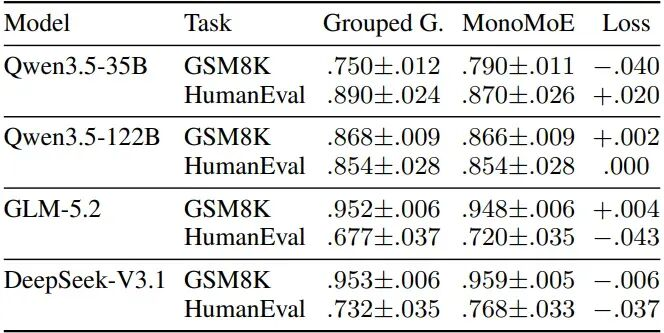

::: image-caption
表 3：批量大小为1时的端到端下游任务精度，报告为均值±二项式标准误。精度损失为分组GEMM均值减去MonoMoE均值，因此越低越好。所有模型的两个任务上，精度差异都在误差范围内，部分场景MonoMoE甚至略优。这说明权重主导的调度和融合设计，没有对模型的生成质量产生负面影响，是完全无损的性能优化。
:::

结果显示，**在所有模型和两个任务上，MonoMoE 都保留了分组 GEMM 的服务精度**：每当 MonoMoE 的平均分更低时，差值都小于组合标准误差；其余所有结果都显示两者相当或 MonoMoE 更优。

:mdnice-bold-italic[这意味着，将基线 MoE 路径替换为 MonoMoE，在完整服务栈中不会引入可测量的精度下降]。性能提升是完全“免费”的，不需要付出精度代价。

::: block-1
整体看下来，:mdnice-highlight[MonoMoE 的性能表现是全方位的：内核级大幅领先基线与竞品，数值精度完全对齐参考，端到端延迟显著降低，下游任务精度无损失]。同时它还解决了 FlashMoE 的调度容量限制问题，能够适配更多模型和配置。无论是性能还是通用性，都达到了生产级可用的标准。
:::

## 七、总结与展望：MoE 推理内核的演进方向

> MonoMoE 的核心贡献，**不仅是一个更快的 MoE 内核，更是提出了一种全新的调度范式，为小批量解码场景的 MoE 优化指明了方向。**

当然它也有自己的适用边界，未来还有很多可以拓展的空间。

### 7.1 MonoMoE 的适用边界与局限

> MonoMoE 的目标场景是内存绑定的自回归解码，且**每个 GPU 上并发处理的 Token 数 B 较小。它的最强区间是 $B≤8$，此时完整的 Token tile 刚好适配最小的细粒度张量核心 N 形状**，而 Token 主导的分组 GEMM 通常为每个激活专家分配一个填充不足的 M tile 。

随着 B 增大，更多的路由 Token 会填满 Token 主导的 M tile ，分摊 Token 排序、启动边界和流水线填充/排空开销。内核级加速比从 B=1 时的 1.19–1.54 倍下降到 B=8 时的 1.02–1.17 倍，端到端 TPOT 降低从 11.5–18.7%下降到 2.9–9.9%。

更长的解码上下文本身不会增加 B，但预填充和分块预填充会一起处理很多序列位置，提供足够的 Token 轴并行性来分摊分发开销。**因此 MonoMoE 主要针对 $B≤8$ 的解码步；对于更大的 Token 集合，分组或批量 GEMM 会越来越合适。**

### 7.2 分布式场景的融合空间

> MonoMoE 将专家计算融合到一次持久化启动中，但分区 MoE 层仍然需要分布式通信：张量并行需要对层输出做 all-reduce，专家并行需要将 Token 分发给专家所有者并返回结果。

在单节点小批量解码场景下，将这些集合操作融合进内核并没有收益。因为 NVLink 传输小消息只需要几微秒，跨秩同步才是主要的暴露开销。等待的持久化内核会让每个 SM 上都驻留一个 CTA，导致网格空转，同时通信流量与带宽绑定的专家权重流竞争带宽。

张量并行没有有用的重叠窗口，因为它的 all-reduce 是终端操作，且 MonoMoE 基于 atomicAdd 的累加要等到所有贡献的专家组完成后才会产生输出元素。提前暴露部分结果需要每组缓冲区，大致会让输出流量翻倍并增加一次归约遍历，而接收端仍然要等待最慢的秩。**因此在 MonoMoE 的目标场景下，独立的张量并行集合操作仍然更优；在更高张量并行度或预填充期间，融合会更有吸引力，因为更大的传输量提供了有意义的重叠机会。**

对于专家并行，研究人员也实现了使用对称对等内存的融合分发与合并：秩将 Token 和部分输出暂存到对等映射缓冲区中，内核在路由期间对等读取远程激活，并对每个秩拥有的行求和，替代了对应的 all-gather 和 reduce-scatter 操作。这个实现是正确的，但性能与基线相当，因为短暂的 NVLink 传输没有改变固有的秩间等待，而共享专家——唯一的独立计算——已经被运行时重叠。

在更大批量、更高专家并行度或跨扩展互连的场景下，权衡会发生变化。更大的有效载荷和更长的专家 GEMM 会创造有用的重叠窗口，此时通信重叠的 MegaKernel 可以在后续 Token 仍在传输时处理先到达的专家。

### 7.3 未来演进方向

> MonoMoE 的工作打开了权重主导调度的大门，未来还有几个值得探索的方向。

- **首先是更细粒度的量化支持**。当前 MonoMoE 支持 FP8 分块量化，未来可以扩展到 INT4、INT8 等更低位宽的量化格式，进一步减少权重流量，提升内存绑定场景的性能。
- 其次是更广泛的硬件适配。当前实现针对 Hopper 架构优化，未来可以**扩展到 Blackwell、AMD MI 系列等更多硬件平台**，让更多场景享受到权重主导调度的收益。
- 第三是与通信的深度融合。**在多节点、高并行度的场景下**，探索内核内通信与计算的重叠，进一步降低分布式 MoE 的端到端延迟。
- 最后是与其他算子的融合。比如将注意力算子也融合到同一个持久化内核中，实现整层甚至整模型的单内核执行，进一步消除内核边界开销。

::: block-1
总之，MonoMoE 的核心价值在于:mdnice-highlight[打破了 Token 主导调度的思维定式，为小批量 MoE 解码找到了更适配硬件的并行范式]。它不仅带来了立即可用的性能提升，更为 MoE 推理内核的演进提供了新的思路。随着 MoE 模型的普及，这种权重主导的持久化内核设计，很可能会成为解码场景的标准方案。
:::

::: related-title
**相关推荐**
:::

::: related-links
- [较 SGLang 1.21 倍提速！ForgeMegakernel 开启 AI 推理 MegaKernel 的自动化锻造时代](https://mp.weixin.qq.com/s?__biz=MjM5NDczOTA4NQ==&mid=2447905880&idx=1&sn=d33d843035f0dfc0a9af3f02f2811a94&scene=21#wechat_redirect)

:::

::: related-links
- **[2122 Tokens/s 巅峰性能！从 MegaKernel 到 PDL：NaiveRT 将 RL Rollout 性能推向极限！](https://mp.weixin.qq.com/s?__biz=MjM5NDczOTA4NQ==&mid=2447906316&idx=1&sn=a4035048c843aaace742978bd79b5704&scene=21#wechat_redirect)**
- **[Weave：面向计算通信重叠的 MoE MegaKernel 细粒度动态 SM 调度，较 DeepEP 1.95 倍层加速，1.12 倍端到端提速](https://mp.weixin.qq.com/s?__biz=MjM5NDczOTA4NQ==&mid=2447906220&idx=1&sn=177db891e7fc7087f94090009ef44dc4&scene=21#wechat_redirect)**
- **[较 SGLang 1.21 倍提速！ForgeMegakernel 开启 AI 推理 MegaKernel 的自动化锻造时代](https://mp.weixin.qq.com/s?__biz=MjM5NDczOTA4NQ==&mid=2447905880&idx=1&sn=d33d843035f0dfc0a9af3f02f2811a94&scene=21#wechat_redirect)**
- **[拆解 megakernel 性能神话：普通 CUDA 内核靠 PDL 调度实现 97.4%持久化吞吐](https://mp.weixin.qq.com/s?__biz=MjM5NDczOTA4NQ==&mid=2447905121&idx=1&sn=f93dceb62089296ffcabc24c964e94c3&scene=21#wechat_redirect)**
- **[Cursor 开源了面向 GB300 NVL72 的生产级 MoE 训练 megakernel，支撑万卡模型训练！](https://mp.weixin.qq.com/s?__biz=MjM5NDczOTA4NQ==&mid=2447904378&idx=1&sn=83e25209c3e1ffc683b97a6f8646f250&scene=21#wechat_redirect)**
- **[PDL vs Megakernel：两类Kernel延迟优化方案的本质差异](https://mp.weixin.qq.com/s?__biz=MjM5NDczOTA4NQ==&mid=2447903286&idx=1&sn=a9cff3297f146d77532935b6056a9290&scene=21#wechat_redirect)**
- **[AutoMegaKernel 背后这家公司 RightNow AI 的产品矩阵、研究版图与技术哲学](https://mp.weixin.qq.com/s?__biz=MjM5NDczOTA4NQ==&mid=2447903030&idx=1&sn=d7de3a5385a1e87bcf5ecbc260431708&scene=21#wechat_redirect)**
- **[AutoMegaKernel：Agent驱动、跨GPU架构的MegaKernel方案，静态校验全模型单巨内核，最高提速 1.33 倍！](https://mp.weixin.qq.com/s?__biz=MjM5NDczOTA4NQ==&mid=2447903011&idx=1&sn=7872d080a5475a44bba4cfabe7717b56&scene=21#wechat_redirect)**
- **[实测提速 16%：硬件光追下 MegaKernel 与波前路径追踪的 GPU 性能对照](https://mp.weixin.qq.com/s?__biz=MjM5NDczOTA4NQ==&mid=2447902818&idx=1&sn=fab8996b09f6a940673d007317e08657&scene=21#wechat_redirect)**
- **[从 MegaKernel 视角重新定义 NPU 上的线性注意力极限！PTO-ISA 驱动的昇腾 NPU Gated DeltaNet MegaKernel 浅析](https://mp.weixin.qq.com/s?__biz=MjM5NDczOTA4NQ==&mid=2447901380&idx=1&sn=4ae6987a6ba87626737c46cb4be9458e&scene=21#wechat_redirect)**
- **[MoE 训练提速最高 38%！字节 Seed 开源 UniEP：首个训练级 MegaKernel 架构，重新定义专家并行训练的性能天花板！](https://mp.weixin.qq.com/s?__biz=MjM5NDczOTA4NQ==&mid=2447901263&idx=1&sn=91b18cdbc9fc8949c2277baf3de23826&scene=21#wechat_redirect)**
- **[10.3 倍加速！康奈尔大学 Perseus：终结多节点 MoE MegaKernel 的隐藏序列化噩梦，让代理传输反超 GPU-direct 1.2 倍！](https://mp.weixin.qq.com/s?__biz=MjM5NDczOTA4NQ==&mid=2447901207&idx=1&sn=4e68da37ab9ecd3a8d20e16451ea6ebe&scene=21#wechat_redirect)**
- **[AMD 提出多芯粒 GPU 的 MegaKernel 方案 Fleet：通过 Chiplet 任务抽象将 L2 命中率从 12%提升至 54%，解码延迟降低 1.5 倍](https://mp.weixin.qq.com/s?__biz=MjM5NDczOTA4NQ==&mid=2447900183&idx=1&sn=67b81e638e55f882448bf5b586e53167&scene=21#wechat_redirect)**
- **[超越 vLLM 与 SGLang！Event Tensor：以动态 MegaKernel 消除重编译，解锁GPU核间通信-计算重叠](https://mp.weixin.qq.com/s?__biz=MjM5NDczOTA4NQ==&mid=2447900086&idx=1&sn=fb8be688929f686853cc12c815e759ae&scene=21#wechat_redirect)**
- **[性能相比SGLang/vLLM最高提升1.7倍！Mirage Persistent Kernel：首个自动巨核化多GPU LLM推理的编译器-运行时系统，细粒度计算-通信重叠](https://mp.weixin.qq.com/s?__biz=MjM5NDczOTA4NQ==&mid=2447895728&idx=1&sn=88a267756d2f2057f868d43f0500841f&scene=21#wechat_redirect)**
- **[性能超 Mirage、TVM、PyTorch！CMU 清华提出 Prism：符号化超优化终结张量程序枚举爆炸，在 LLM 核心负载上最高加速 2.2 倍](https://mp.weixin.qq.com/s?__biz=MjM5NDczOTA4NQ==&mid=2447901362&idx=1&sn=6740959d78e8f65f2c0fdaf740fdde2f&scene=21#wechat_redirect)**

:::
